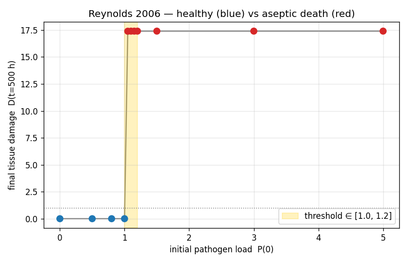

# Demo

A one-command, self-contained reproduction of the Reynolds 2006 result.

```bash
# after `uv pip install -e .` (see the top-level README)
python demo/demo.py
# or, from a fresh checkout, with no prior install:
uv run python demo/demo.py
```

It prints:

1. the model's citation and provenance;
2. a **validation table** — every scenario checked against the published steady
   states, run through viva-tellurium;
3. a **sweep of the initial pathogen load `P(0)`**, where the outcome flips from
   *healthy* to *aseptic death* between `P(0) = 1.0` and `1.05`; and
4. writes `demo/bifurcation.png` — final tissue damage vs initial pathogen load.

Expected tail:

```
  P(0) = 1.00  ->  final tissue damage D =   0.001   healthy
  P(0) = 1.05  ->  final tissue damage D =  17.388   ASEPTIC DEATH
  ...
✓ Reproduced the published result: reynolds-2006-acute-inflammation OK
```



A whole tissue's worth of damage appears from a 5% increase in the starting
pathogen dose — the self-sustaining inflammation the paper is about.
