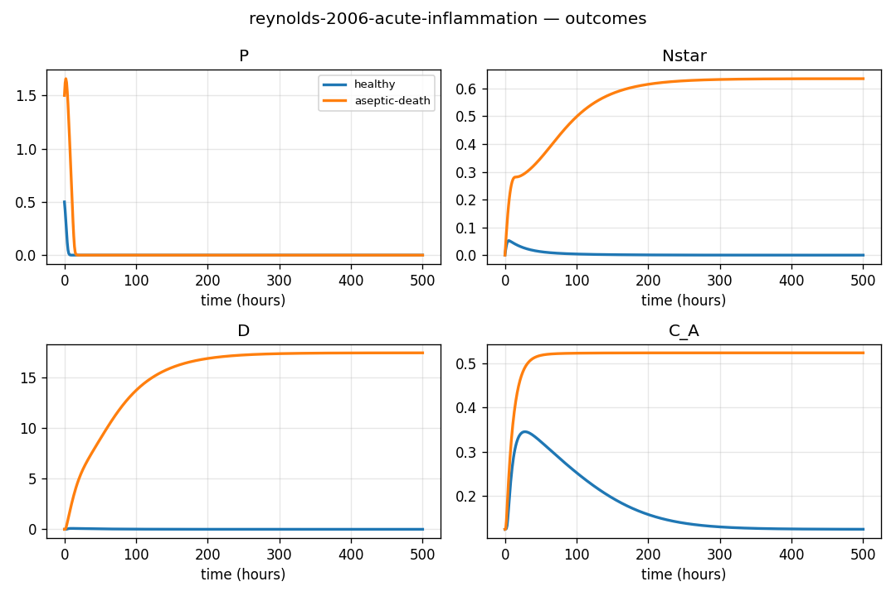

# Reynolds 2006 — Reduced model of the acute inflammatory response

A four-equation ODE model of the innate immune response to infection. It is the
canonical "reduced" model in the sepsis-modeling literature and underpins much
of the later acute-inflammation work relevant to INFLECT.

| | |
|---|---|
| **State** | `P` pathogen · `Nstar` activated phagocytes · `D` tissue damage · `C_A` anti-inflammatory mediators |
| **Source** | Reynolds et al., *J. Theor. Biol.* 242(1):220–236, 2006 · [DOI](https://doi.org/10.1016/j.jtbi.2006.02.016) |
| **Curated SBML** | BioModels [BIOMD0000000714](https://www.ebi.ac.uk/biomodels/BIOMD0000000714) |
| **Model file** | [`model.ant`](./model.ant) (Antimony, rate-rule form) |

## The equations

```
f(N*) = N* / (1 + (C_A/c_inf)^2)                      # anti-inflammatory damping
R     = (k_nn·N* + k_np·P + k_nd·D) / (1 + (C_A/c_inf)^2)

dP/dt    = k_pg·P·(1 − P/p_inf) − k_pm·s_m·P/(mu_m + k_mp·P) − k_pn·f(N*)·P
dN*/dt   = s_nr·R/(mu_nr + R) − mu_n·N*
dD/dt    = k_dn · f(N*)^6/(x_dn^6 + f(N*)^6) − mu_d·D
dC_A/dt  = s_c + k_cn · g/(1 + g) − mu_c·C_A,   g = (N* + k_cnd·D)/(1 + (C_A/c_inf)^2)
```

## Published result reproduced

The model is **bistable** in the initial pathogen load `P(0)`:

- **`P(0) = 0.5` → healthy.** The pathogen is cleared and every variable returns
  to baseline (`P, N*, D → 0`, `C_A → 0.125`).
- **`P(0) = 1.5` → aseptic death.** The pathogen is *also* cleared (`P → 0`), but
  the inflammatory response has become self-sustaining: `D ≈ 17.4`, `N* ≈ 0.64`,
  `C_A ≈ 0.52` — persistent tissue damage with no remaining infection.

The healthy/aseptic boundary sits between `P(0) = 1.0` and `1.2`. This is the
"runaway inflammation after the infection is gone" behaviour the paper analyses.



## Validate / reproduce

```bash
inflect-models validate reynolds-2006-acute-inflammation
inflect-models reproduce reynolds-2006-acute-inflammation   # regenerates figures/outcomes.png
```

Validation targets live in [`card.yaml`](./card.yaml); reference steady states in
[`reference/outcomes.csv`](./reference/outcomes.csv).
